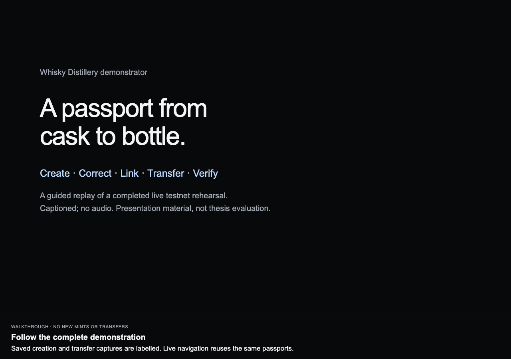

# Whisky Distillery demonstrator

A local web application for Interoperable Digital Product Passports: create cask and bottle records, preserve their revision history, transfer passport tokens to another holder or across testnets, and verify data and token control.

The browser runs locally. **The live demonstrator also requires a running indexer**, access to the configured testnets, and a reachable payload gateway. Writes additionally require authorized accounts, testnet funds and publication credentials. This is a feasibility demonstrator, not a production system.

## Watch the walkthrough

[](apps/web/public/demo/walkthrough.webm)

[Watch the short captioned walkthrough](apps/web/public/demo/walkthrough.webm) · [Transcript and recording notes](docs/WALKTHROUGH.md)

With the web app running, you can also [play it locally](http://localhost:3000/demo/walkthrough.webm).

The recording combines live navigation of the completed rehearsal passports with clearly labelled saved creation and transfer captures. It uses a local signing bridge and the scanner's text fallback. It is presentation material, separate from the thesis evaluation; it is not a continuous new transaction run or a timing benchmark.

## Choose what to test

| Path | What you need | What you can do |
| --- | --- | --- |
| Live reader | Chain-provider URLs, running indexer and web app | Browse actual passports, inspect histories and verification, follow cask links, generate and open labels. No wallet or private key is needed. |
| Full live sequence | Reader setup plus the authorized accounts and credentials described below | Mint a cask, revise it, mint a linked bottle, send it to another chain and prove ownership. |
| Offline browser checks | Dependencies and Playwright's Chromium | Exercise simulated records and wallet interactions. This does **not** test live indexing, publication or delivery. |

The committed [deployment manifest](packages/passport-config/src/generated/manifest.json) identifies `whisky-v2-eval3` on Arbitrum Sepolia, Base Sepolia and Sepolia. Contract addresses, deployment blocks and token identifiers are deployment-specific. Browsing is public; cloning this repository does not grant issuer access.

## 1. Install the application

Install Git, Node.js 22.12 or later, and pnpm 10.28.0 (the version pinned in `package.json`). With an existing Node installation, one way to install pnpm is `npm install --global pnpm@10.28.0`. If you use nvm, run `nvm install` and `nvm use` from `app/` to use `.nvmrc`.

```bash
git clone <repository-url>
cd <repository>/app
pnpm install --frozen-lockfile
```

Use the checkout containing this README. Run all subsequent commands from **`app/`**, not the repository root.

Create local configuration files once; do not overwrite an existing configured file:

```bash
cp apps/indexer/.env.example apps/indexer/.env.local
cp apps/web/.env.example apps/web/.env.local
```

Local environment files are ignored by Git. Never put a private key, provider credential or pinning token into committed files or a `NEXT_PUBLIC_` variable.

## 2. Configure the indexer

Edit `apps/indexer/.env.local`:

```dotenv
PONDER_RPC_URL_421614=<Arbitrum Sepolia HTTPS provider URL>
PONDER_RPC_URL_84532=<Base Sepolia HTTPS provider URL>
PONDER_RPC_URL_11155111=<Sepolia HTTPS provider URL>
DATABASE_SCHEMA=idpp_demo
PORT=42069
```

Replace the placeholders with real remote procedure call (RPC) provider URLs. Each provider must support contract reads and historical event logs **from the deployment block in the manifest**, not just recent blocks. Public providers can prune old logs or impose small request ranges. A provider that only serves the current chain state cannot fully synchronize the passport history.

Optional settings in `.env.example` control the maximum log-block range and spacing between request starts for each chain. Use limits supported by your provider; a larger range cannot recover pruned history. Leave them unset unless needed. If rate-limited, choose request intervals consistent with your provider's quota.

`DATABASE_URL` can stay empty: the indexer then uses an embedded PGlite database in `apps/indexer/.ponder/`. Keep that folder and reuse the same schema on ordinary restarts to retain synchronized data. Do not run two indexers against that embedded database. For a different deployment use a distinct schema; for a longer-running installation, PostgreSQL can be supplied through `DATABASE_URL`.

## 3. Configure the web app

For the live reader, edit these public settings in `apps/web/.env.local`:

```dotenv
NEXT_PUBLIC_INDEXER_URL=http://localhost:42069
NEXT_PUBLIC_PINATA_GATEWAY=gateway.pinata.cloud
NEXT_PUBLIC_BASE_URL=http://localhost:3000
```

The gateway setting is a host name without `https://` or a path. It must be able to retrieve the deployment's published payloads. The base origin is encoded into downloadable quick-response (QR) labels.

**Keep `NEXT_PUBLIC_INDEXER_URL` set for live discovery.** Leaving it empty enables clearly labelled fixture mode; it does not discover a local indexer automatically. Fixture mode is not the full live demonstrator and does not disable the write endpoints.

For a read-only installation, leave the server credentials empty. The readiness panel will report publication as unavailable; public reading still works. A WalletConnect project identifier is optional: without one, the app offers browser-injected wallets only.

### Additional requirements for live writes

Install a browser-injected Ethereum wallet that supports the three configured testnets and typed-data signing. Enable its testnet networks, then use **Connect Wallet** in the app. Approve network-switch prompts when revising, sending or signing an ownership challenge. Obtain testnet gas from the relevant networks' faucets; this sequence does not need mainnet funds.

Create a Pinata account/API token with publication permission, and configure the following server-only values for the full sequence:

| Setting | Required value |
| --- | --- |
| `OPERATOR_PRIVATE_KEY` | A dedicated testnet account's `0x`-prefixed private key. That account must be an on-chain issuer and have minting gas on the issuing chain. |
| `ISSUER_ALLOWLIST` | Comma-separated wallet addresses permitted to request minting through this server. Include the wallet you will connect in the browser. |
| `PINATA_JWT` | Your Pinata API token with permission to publish payloads using the configured upload path. |
| `PINATA_UPLOAD_PATH` | Keep the example's `sdk` setting unless intentionally using the existing `legacy` path. |

The operator signs mint transactions. The connected browser wallet signs creation requests, and must separately hold the **on-chain issuer role** to revise records. A token holder can send the token, but ownership does not grant revision rights. For the simplest authorized rehearsal, the same dedicated testnet account can serve as operator, issuer and recipient.

On the existing deployment, issuer rights must come from its contract administrator; adding an address to `ISSUER_ALLOWLIST` alone does not grant that role. An independent reader without such authorization can run the reader, but cannot complete the write sequence on this deployment. For your own deployment, follow the [contract deployment/configuration guide](../smart_contracts/README.md), synchronize its manifest and contract interface into `passport-config`, and rebuild the app. The web app does not deploy contracts or administer issuer roles.

Optional server RPC overrides are documented in `.env.example`. The browser independently uses the configured chains' default public providers, so server or indexer connectivity alone does not prove browser connectivity. Use dedicated testnet keys only, and fund the accounts on the networks where they submit transactions. The sender needs the quoted messaging fee plus transaction gas. Ownership proof itself costs no gas.

## 4. Build, start the indexer, then start the web app

Build the shared package before invoking a package directly:

```bash
pnpm --filter @idpp/passport-config build
```

In **terminal A**, from `app/`, start the indexer and leave it running:

```bash
pnpm --filter indexer start --port 42069
```

Ponder reads `.env.local`, not `.env`. Its port, the `PORT` setting, and the web app's `NEXT_PUBLIC_INDEXER_URL` must agree. First synchronization can take time, depending on historical-log access and provider quotas. Check startup output for a silently selected alternative port if 42069 was occupied.

In **terminal B**, also from `app/`:

```bash
pnpm --filter web build
pnpm --filter web start --hostname 127.0.0.1 --port 3000
```

Open **<http://localhost:3000/>**. Both terminal processes must remain running during the live sequence. Stopping them with Ctrl+C preserves the local indexer database; restarting with the same configuration resumes synchronization.

Public variables are embedded at build time. After changing the indexer URL, gateway, label origin or deployment manifest, rebuild the web app and restart it. If using the workspace's cached build command, force it with `pnpm exec turbo run build --force`.

For editing only, `pnpm --filter web dev` can replace the production web commands. Prefer the persistent `indexer start` process over rapid PGlite development reloads for a presentation.

## 5. Confirm readiness

On the list page choose **Check readiness** and inspect the details:

- Every manifest chain should have an indexed checkpoint within the displayed catch-up allowance.
- Browser contract reads should pass on all three networks.
- For a full write rehearsal, publication configuration should be present and the connected presenting wallet should be allowlisted.

A reachable `/ready` endpoint alone is insufficient: historical backfill can finish before realtime indexing reaches the chain head. Readiness details are a dated snapshot, not continuous monitoring. Recheck after changing services or wallets.

For a command-line view of indexer progress:

```bash
curl --fail http://localhost:42069/api/status
```

A successful HTTP response can still contain `caughtUp: false`. Missing progress, a mismatched deployment, fixture mode or a failed dependency is not a live pass. Publication configuration checks do not authenticate an upload credential, check on-chain issuer roles or gas balances, or guarantee delivery. Rehearsing an actual authorized write checks those paths.

## 6. Test the complete demonstration sequence

Use **your actual new token identifiers** and recipient address throughout. Samples in the forms are editable. Live operations publish real payloads and leave real testnet tokens and transactions behind; they are not rolled back when the app closes.

| Step | Action | What to verify |
| --- | --- | --- |
| Create a cask | On **Mint**, select Cask, Item and Arbitrum Sepolia. Use Demonstrator Distillery, Ex-bourbon oak, a unique cask number, 200 liters, 63.5% and fill date 2026-10-01. Set the recipient to the presenting holder wallet and choose **Sign and mint**. | A successful response supplies a token identifier, content reference and transaction link. Follow **Open /passport/…**. |
| Inspect its record | Wait for indexing and verification to settle. Expand the payload data. | The token is held on Arbitrum Sepolia at revision 0. The plain-language result agrees with the detailed checks. |
| Correct the cask | With the issuer wallet, choose **Revise**, change volume to 199.3 liters, describe an illustrative correction, then **Pin and revise**. Sign the publication challenge and the transaction. | Revision 1 is recorded under the same identifier; both revisions remain inspectable. This is an issuer's correction, not an automatically measured withdrawal. |
| Create a bottle | Mint Bottle / Item on Arbitrum Sepolia: Demonstrator Reserve, Single malt whisky, 700 ml, 46%, and a suitable bottling date. **Add source cask**: the actual cask identifier, revision **1**, volume **700 ml**. | Bottle revision 0 verifies. Its source link opens the cask history and names the declared revision. Publication validates the source reference; it does not deduct volume or enforce aggregate allocation across bottles. |
| Save the label | On the bottle page choose **Download PNG** and **Copy link**. | The label carries deployment and token identity, not the current chain. Keep this exact label for the post-transfer check. |
| Send the bottle | With its holder wallet connected, choose **Send to another chain**, select Base Sepolia and check the receiver. Review the fee and choose **Send** once. | Source confirmation, observed arrival and direct destination confirmation are separate stages. Keep the page open while waiting. |
| Reopen the label | After destination confirmation and indexer catch-up, scan the saved label or paste its URL into **Scan**. | The same token now resolves to Base Sepolia, preserving its revision, payload reference, history commitment and source-cask relationship. The timeline links source and destination transactions. |
| Prove ownership | On the bottle choose **Verify owner**, then **Create ownership challenge**. In a second window/device open **Prove ownership**, scan or paste the challenge, read it and sign with the holder wallet. Return the proof to the original verifier window. | A fresh owner read and the verifier's unused, unexpired challenge are required. A successful proof is consumed; submitting it again is rejected. No transaction is needed. |

Content, passport/revision binding, predecessor links, transaction receipts and the history commitment have separate results. **Unavailable** and **unconfirmed** do not mean verified. A **failed** check is a detected mismatch. These checks do not establish physical authenticity, custody or the truth of the issuer's product claims. Ownership proof is limited to supported externally owned wallets; contract wallets are unsupported, and a relayed proof can pass.

### Short checklist

- [ ] Indexer and web server are running; all required readiness checks pass.
- [ ] Issuer, operator and holder permissions and funds are prepared; wallets are on the expected testnets.
- [ ] Record the new cask and bottle identifiers and transaction links.
- [ ] Show the cask correction, both revisions and the bottle's source link.
- [ ] Save the bottle label **before** sending; reopen that same label **after** arrival.
- [ ] Keep the source send page open until destination confirmation.
- [ ] Create a fresh ownership challenge during the demonstration; it expires after two minutes. Preserve its original verifier tab.
- [ ] Keep an already-delivered rehearsal passport and text-scanning fallback available. Identify any fallback explicitly.

For a phone, `localhost` means the phone itself. Use a reachable HTTPS origin for the web app, a browser-reachable indexer URL, and a rebuilt `NEXT_PUBLIC_BASE_URL`. Camera and clipboard features require a secure context; localhost is suitable for a same-computer rehearsal. Two desktop windows with text input avoid the camera requirement.

## Troubleshooting

| Symptom | Action |
| --- | --- |
| “Mock data” banner | Set `NEXT_PUBLIC_INDEXER_URL`, rebuild, restart. Live discovery needs the indexer. Fixture mode is not a safe write sandbox. |
| Indexer unreachable / failed to fetch | Keep terminal A running; check its actual listening port and the web build's URL. Remote browsers also need access to that URL. |
| History pruned or backfill stalls | Use providers retaining logs from the manifest's deployment blocks. Check quotas and supported log ranges. Repeatedly changing ranges cannot restore missing history. |
| Location incomplete | Inspect per-chain readiness. Wait for catch-up and reload; conflicting observations can also make location incomplete. Do not turn unavailable evidence into a success claim. |
| Mint refused / `not_allowlisted` | Configure the presenting wallet in the server allowlist; ensure the operator separately has the on-chain issuer role and gas. Restart after server-setting changes. |
| Revision refused / `not_issuer` | Connect an account authorized as issuer on the holding chain; token ownership alone is insufficient. |
| Stale revision | Reload the current payload and prepare a new draft. Do not resubmit the obsolete version. |
| Pin or gateway error | Check publication configuration, permissions and payload availability. Inspect the earlier transaction before retrying a mint with an uncertain outcome. |
| Slow transfer | Check both transaction links and destination ownership. “Not yet observed” is not proof of failure; do not try to resend an in-flight token. Delivery recovery has no application page; **Transfer ownership** only changes the holder on the current chain. |
| Camera unavailable | Use the existing label/challenge/proof text field. Keep the original verifier tab; generate a new challenge after expiry or consumption. |
| Readiness API missing | Restart the indexer from the same checkout as the web app. |

## Automated checks

Unit tests require no live services or credentials:

```bash
pnpm test
pnpm checkTs
```

For the offline browser suite:

```bash
pnpm --filter web exec playwright install chromium
pnpm --filter web test:e2e
```

This suite intentionally builds the web app with fixtures. **Rebuild and restart the web app with your live configuration afterward** before resuming a live demonstration. It does not test your real wallet extension or physical camera.

## Development

All workspace scripts run from `app/` through Turborepo:

```bash
pnpm dev             # web app and indexer in watch mode
pnpm build           # build @idpp/passport-config and the web app
pnpm checkTs         # type-check every package (tsc --noEmit)
pnpm lint            # Biome check in every package
pnpm format          # apply Biome fixes to the whole workspace
pnpm test            # unit tests (Vitest) in every package
pnpm test:coverage   # unit tests with V8 coverage
```

Run one package's tests with `pnpm --filter <package> test`, where the package is `@idpp/passport-config`, `indexer` or `web`. Build `@idpp/passport-config` first when invoking another package's script directly. After a contract redeployment, `pnpm --filter @idpp/passport-config sync-contracts` copies the deployment manifest and contract interface from `../smart_contracts`.

Live suites run against the testnets and need a running indexer; the write suites also need the server credentials described above: `pnpm --filter web test:e2e:live`, `pnpm --filter web test:e2e:indexer`, `pnpm --filter indexer test:live` and `pnpm --filter @idpp/passport-config test:int`. The write suites spend testnet gas and publish payloads; none of them is required for the manual guide above.
